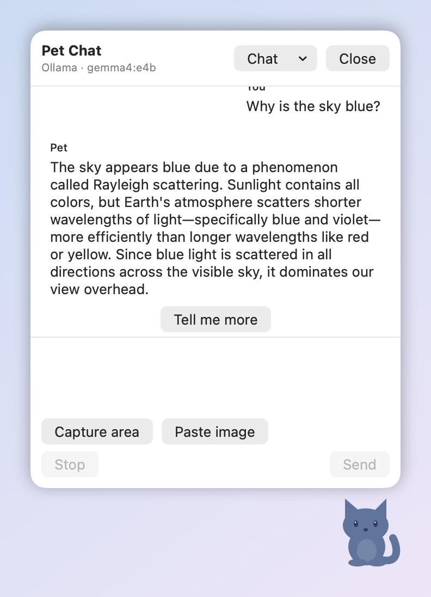
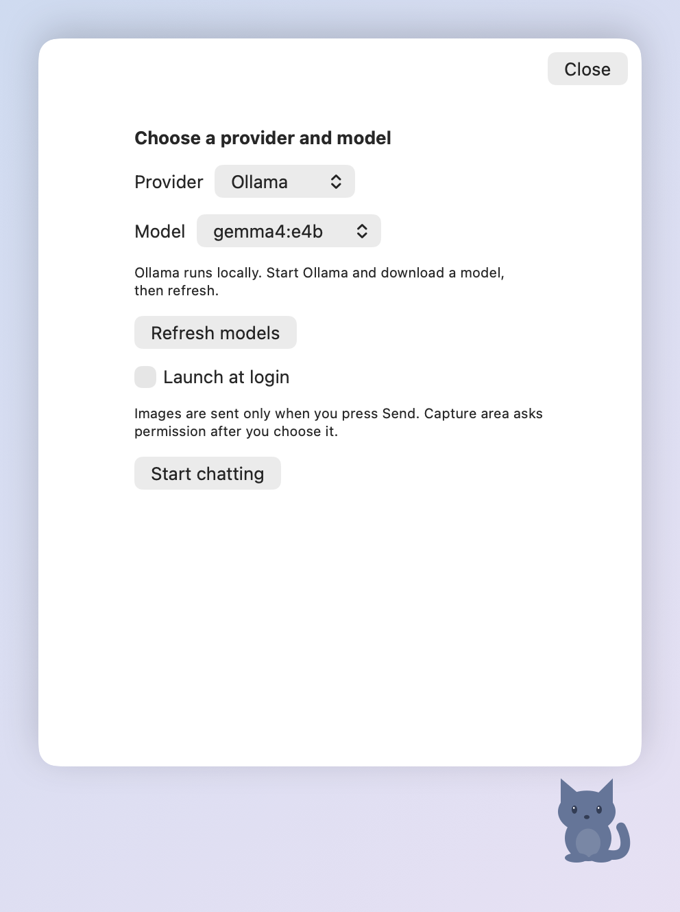

# Pet Chat

A little cat that lives in the corner of your Mac's screen. Click it, ask a question, and get a short answer without leaving what you're doing.

<p align="center"></p>

## What you need

- A Mac running macOS 14 or newer.
- An AI to talk to. Pick one:
  - **Ollama** (free, runs on your Mac, private). Install it from [ollama.com](https://ollama.com) and download a model, for example `ollama pull gemma3`.
  - **ChatGPT** (uses your ChatGPT account; no API key needed). Your account must be eligible; see [OpenAI's guide](https://developers.openai.com/siwc/token-sharing-open-source).

## Install

1. Download `PetChat-<version>.dmg` from the [Releases page](https://github.com/EtreResearch/pet-chat/releases/latest).
2. Open it and drag **Pet Chat** onto **Applications**.
3. Open **Pet Chat** from Applications.
4. macOS will say it can't check the app for malicious software. Click **Done** (or **OK**), then open **System Settings → Privacy & Security**, scroll down to the Pet Chat message and click **Open Anyway** (it only appears after you've tried to open the app once), then confirm with your password. You only do this once. (Pet Chat isn't signed with an Apple Developer ID yet, which is why macOS asks.)

The cat appears in the bottom-right corner. Pet Chat shows in the Dock and the menu bar. If you'd rather keep it to the menu bar only, turn off **Show in Dock** in Settings.

### Updating

Download the new DMG and drag **Pet Chat** to Applications, replacing the old copy. If you use ChatGPT, macOS may ask once whether Pet Chat can use its saved keychain item. Click **Always Allow**.

## Use it

1. **Click the cat**, click the Dock icon, or press **Control + Option + Space** from any app.
2. The first time, choose who answers you, then click **Start chatting**:

   

   - For **Ollama**, choose a model (click **Refresh models** if the list is empty).
   - For **ChatGPT**, click **Connect ChatGPT** and approve the sign-in in your browser.
3. Type your question and press **Return** (Shift + Return for a new line), or click **Send**. The box empties when you send.
4. Want a longer answer? Click **Tell me more**.
5. Press **Escape** or **Close** to tuck the chat away. Your unsent text stays.

### Handy extras

- **Show the AI something on screen:** click **Capture area** and drag over part of your screen, or copy a picture and click **Paste image**. Nothing is sent until you press **Send**. The first capture asks for Screen Recording permission.
- **Stop** cuts an answer short. **Retry** tries again if something failed.
- **Chat menu:** start a **New Chat**, **Change model**, or **Delete Chat**.
- **Move the cat** by dragging it.
- **Menu-bar cat:** hide or show the pet, open **Settings** (change the shortcut, pick a screen, make the text bigger, show or hide Pet Chat in the Dock, sign out of ChatGPT, launch at login), or **Quit**. **Settings…** (Command + ,) and **Quit** are also in the Pet Chat menu.

## Privacy

- Your chats and images are stored only on your Mac, in `~/Library/Application Support/PetChat`. They are not encrypted.
- With Ollama, nothing leaves your Mac.
- With ChatGPT, your question, recent messages from the same chat, and any attached image go to OpenAI when you press **Send**. Your ChatGPT login is kept in the macOS Keychain.
- **Sign out of ChatGPT** stops requests, attempts to end the remote session, and removes local tokens. The app keeps the account's registration for later sign-in. If remote revocation cannot be confirmed, Settings shows a warning to disconnect the app in ChatGPT Settings.

## For developers

### Build from source

You need Xcode. In Terminal, from this folder:

```sh
xcodebuild build -project PetChat.xcodeproj -scheme PetChat -configuration Release -destination 'platform=macOS' -derivedDataPath /private/tmp/pet-chat-release CODE_SIGN_IDENTITY=- CODE_SIGNING_ALLOWED=YES
mkdir -p build && ditto /private/tmp/pet-chat-release/Build/Products/Release/PetChat.app build/PetChat.app
open build/PetChat.app
```

To build a DMG locally, run `scripts/make-dmg.sh 0.1.0`. The result is `dist/PetChat-0.1.0.dmg` (universal, ad-hoc signed).

### Releasing

```sh
git tag v0.1.0 && git push origin v0.1.0
```

Wait for the Release workflow to finish (it runs the unit tests and builds the DMG), then review and publish the draft on the [Releases page](https://github.com/EtreResearch/pet-chat/releases).

### Tests

Swift 6, SwiftUI/AppKit and SwiftData. The project has no third-party dependencies. Run the unit and UI tests:

```sh
xcodebuild test -project PetChat.xcodeproj -scheme PetChat -destination 'platform=macOS' -parallel-testing-enabled NO CODE_SIGN_IDENTITY=- CODE_SIGNING_ALLOWED=YES
```

Builds are ad-hoc signed and not notarized, so the first launch needs **Open Anyway** (see Install). The design is in [`docs/superpowers/specs`](docs/superpowers/specs/2026-10-11-macos-pet-chat-design.md). The screenshots are rendered from the app's own views, with a real answer from a local Ollama model.

Not yet checked by hand: live ChatGPT sign-in, VoiceOver, multiple displays and full-screen apps, real screen capture, Login Items approval, and macOS 14.
